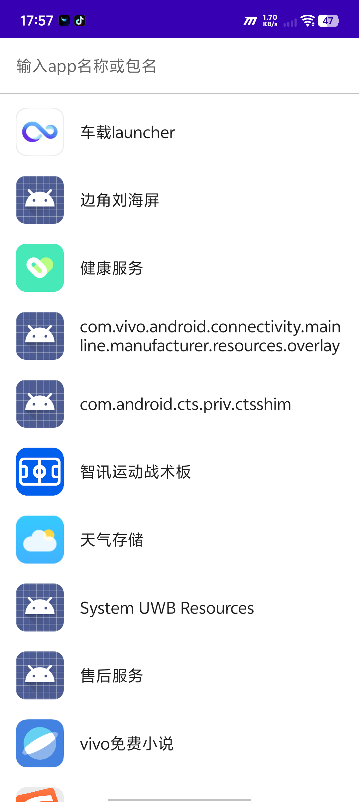
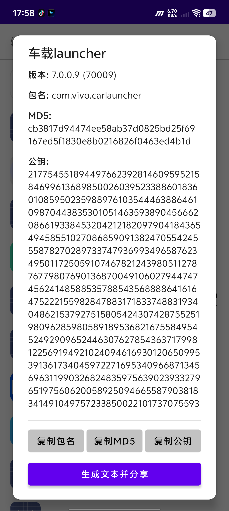

# 获取app签名信息

用于查看 Android 已安装应用的包名、版本、MD5 和公钥信息。

## 下载安装

[下载 app-debug.apk](app-debug.apk)

## 功能

- 按应用名称或包名搜索
- 查看应用版本、包名、MD5 和公钥
- 一键复制包名、MD5、公钥
- 生成签名信息文本并通过系统分享

## 界面预览

| 应用列表 | 签名详情 |
| --- | --- |
|  |  |
